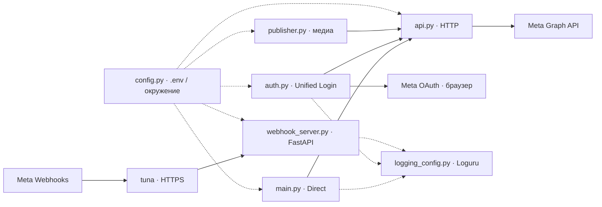

# Instagram Graph API Toolkit

Python-инструментарий для интеграции с Instagram через Meta Graph API: авторизация
через Meta Unified Login, чтение диалогов Direct, публикация медиа и приём webhook-событий.
Проект объединяет функции Python API, сценарий чтения переписки и отдельный
диагностический FastAPI-сервер; общий HTTP-слой и изолированные тесты поддерживают
единые правила работы с внешним API.

## Возможности

| Направление | Реализовано |
| --- | --- |
| Authentication | Meta Unified Login: вход через браузер, проверка редиректа, обмен кода и сохранение бизнес-токена; отдельная функция выпуска нового токена |
| Direct message retrieval | Выбор назначенного Instagram-аккаунта и вывод полученной страницы диалогов с вложенными сообщениями |
| Media publishing | Фото, Reels, Stories и карусели из 2–20 элементов IMAGE/VIDEO; создание и публикация контейнеров, ожидание обработки видео |
| Webhook handling | Проверка callback, проверка подписи и структуры событий Instagram, ответ о приёме и счётчики событий без сохранения тела |

Это реализованные сценарии, а не подтверждение работы всех операций на реальном
аккаунте. Границы проверки описаны в разделе [Состояние и ограничения](#состояние-и-ограничения).

## Архитектура



Сплошные стрелки показывают вызовы и поток запросов, пунктирные — настройки и
логирование. `main.py` только читает Direct; авторизация и публикации вызываются
явно из Python. Webhook-сервер запускается отдельно и не вызывает Graph API.
Подробности модулей — в [описании архитектуры](docs/ARCHITECTURE.md).

## Инженерные решения

| Решение | Назначение и обоснование |
| --- | --- |
| Централизованный HTTP-слой | `api.py` объединяет GET/POST, версию API, Bearer-авторизацию, тайм-ауты, закрытие ресурсов и безопасные ошибки; модули не дублируют транспортную логику |
| OAuth state и redirect URI | Случайный `state` связывает ответ с попыткой входа; проверка адреса редиректа и единственного кода отклоняет неподходящие ответы до обмена токена |
| HMAC-SHA256 для webhook | Подпись вычисляется по исходным байтам тела с `APP_SECRET` и сравнивается через `hmac.compare_digest`, чтобы проверить подлинность и целостность события |
| App Secret Proof | `auth.refresh()` добавляет `appsecret_proof` к запросу выпуска бизнес-токена, подтверждая владение секретом приложения |
| Безопасное логирование | Общий Loguru пишет в консоль без файлов, сырых HTTP-ошибок и значений локальных переменных; webhook выводит результаты и счётчики. Сценарий Direct намеренно показывает переписку в консоли |
| Ограничение чтения webhook | Лимит тела 1 МиБ и 10 секунд на чтение ограничивают расход памяти и время ожидания входящего запроса |
| Изолированное тестирование | HTTP-моки, ASGITransport, фиктивные настройки и блокировки сети позволяют проверять ошибки и контракты без аккаунта и настоящего `.env` |

## Технологический стек

- **Python 3.13**, Requests — функции интеграции и HTTP-запросы к Graph API.
- **FastAPI, Uvicorn** — ASGI-приёмник webhook; **tuna** — внешний HTTPS-туннель для диагностики.
- **Loguru, python-dotenv** — централизованное логирование и локальные настройки.
- **pytest, HTTPX** — изолированные тесты; **Ruff, uv, mise** — проверки, зависимости и задачи разработки.

Версии инструментов закреплены в [mise.toml](mise.toml), зависимости — в
[pyproject.toml](pyproject.toml) и [uv.lock](uv.lock).

## Быстрый старт

1. Установите [mise](https://mise.jdx.dev/getting-started.html), клонируйте репозиторий
   и откройте его корень. Подготовьте закреплённые Python и uv, затем зависимости:

   ```console
   mise trust
   mise install
   mise run setup
   ```

2. Создайте локальный `.env` по [.env.example](.env.example). Для чтения нужны
   `META_ACCESS_TOKEN` типа System-user access token из Unified Login и доступ к
   назначенному Instagram professional account. При нескольких аккаунтах или
   неполной странице назначений укажите `INSTAGRAM_ACCOUNT_ID`. `META_API_VERSION`
   по умолчанию — `v27.0`. Переменные терминала имеют приоритет над `.env`.

   Подготовка Meta-приложения и остальные настройки — в [руководстве по настройке](docs/SETUP.md).
   Если токена ещё нет, используйте [получение токена из Python](docs/AUTHENTICATION.md).

3. Выполните локальные проверки без реального API:

   ```console
   mise run check
   ```

4. Чтобы прочитать доступную страницу Direct реального аккаунта, запустите:

   ```console
   mise run start
   ```

   Сценарий работает без аргументов, проверяет назначенный аккаунт и выводит
   диалоги и сообщения. Он не вызывает публикацию или обновление токена.

Для webhook-диагностики отдельно нужны установленный tuna, `APP_SECRET` и
`WEBHOOK_VERIFY_TOKEN`: в первом терминале `mise run tunnel`, во втором —
`mise run webhook`. Сервер запросит HTTPS-адрес туннеля и выведет Callback URL.
Настройка подписок и проверка доставки — в [руководстве по webhooks](docs/WEBHOOKS.md).

## Использование Python API

Примеры предназначены для Python-окружения проекта и выполняют реальные операции
при вызове. Медиа-URL ниже — образец: замените его своим публичным URL.

### Получение токена

После настройки Meta-реквизитов и redirect URI:

```python
import auth
from logging_config import configure_logging

configure_logging()
token = auth.obtain_token()  # Браузер → проверка редиректа → сохранение в .env.
```

### Чтение Direct

`get_account()` возвращает словарь аккаунта, `show_inbox()` выводит сообщения
через общий logger:

```python
import os

import config
import requests
from logging_config import configure_logging
from main import get_account, show_inbox

configure_logging()
with requests.Session() as session:
    session.headers["Authorization"] = f"Bearer {os.environ['META_ACCESS_TOKEN']}"
    account = get_account(session, config.INSTAGRAM_ACCOUNT_ID)
    show_inbox(session, account["id"])
```

### Публикация фото

Вызов создаёт публикацию в аккаунте из `INSTAGRAM_ACCOUNT_ID` и возвращает её ID:

```python
import os

import publisher

post_id = publisher.post_photo(
    caption="Пример публикации",
    image_url="https://media.example.com/photo.jpg",
    token=os.environ["META_ACCESS_TOKEN"],
)
```

Можно явно передать именованный `account_id`. Остальные типы публикаций и
ограничения ожидания — в [Python API публикаций](docs/PUBLISHING.md);
ручной выпуск и сохранение нового токена — в [авторизации](docs/AUTHENTICATION.md).

## Тестирование

```console
mise run test
mise run lint
mise run check
```

`test` запускает pytest, `lint` — Ruff и проверку форматирования, `check` — обе
проверки. Покрываются чтение Direct, выбор аккаунта, OAuth, выпуск токена,
публикации, подписи и ограничения webhook, безопасные ошибки и логирование.
Сетевые подключения и загрузка настоящего `.env` заблокированы; запись токена
проверяется во временных файлах, webhook — через ASGITransport без HTTP-сервера.
Организация тестов — в [руководстве разработчика](docs/DEVELOPMENT.md#изоляция-проверок).

## Состояние и ограничения

Текущая версия — `0.1.0`. Согласно [зафиксированным результатам](PROJECT_STATUS.md),
реальные GET-запросы чтения аккаунта и Direct были успешны у предыдущей версии.
Получение и выпуск нового токена, все типы публикаций и webhook-приёмник проверены
изолированно. Работа текущей реализации с реальным Meta API и доставка через tuna
не подтверждены этими тестами.

- Direct запрашивает одну страницу: 5 диалогов и по 20 сообщений. Обрабатывается
  весь возвращённый массив; при продолжении выводится предупреждение. Полной
  пагинации, автоматических повторов и отправки сообщений Direct нет.
- Автоматического обновления токенов нет. `refresh()` вызывается явно и не
  сохраняет результат; срок действия токена зависит от конфигурации Meta.
- Публикациям нужны публичные медиа-URL, доступ к аккаунту и соответствующие
  разрешения Meta. Форматы и квоты API код полностью не валидирует.
- Webhook-сервер предназначен для диагностики, не заявлен как production-ready:
  нет очереди, дедупликации и хранения событий; подписки на аккаунт настраиваются отдельно.
- БД и постоянного хранения переписки нет. При чтении Direct сообщения и ID
  видны в консоли; webhook-сервер их не журналирует.

## Документация

- [Оглавление документации](docs/README.md) — выбор руководства по задаче.
- [Настройка](docs/SETUP.md) · [Авторизация и токены](docs/AUTHENTICATION.md).
- [Чтение Direct](docs/DIRECT.md) · [Публикация медиа](docs/PUBLISHING.md) · [Webhooks через tuna](docs/WEBHOOKS.md).
- [Архитектура](docs/ARCHITECTURE.md) · [Разработка и тесты](docs/DEVELOPMENT.md).
- [Состояние и подтверждённые проверки](PROJECT_STATUS.md).
